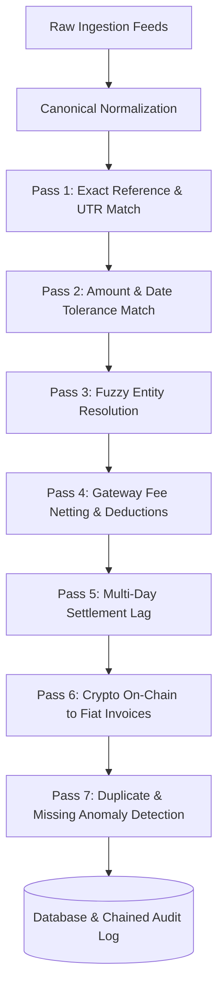

# 🚀 FinRecon — Multi-Source Financial & Blockchain Reconciliation Platform

[](https://fastapi.tiangolo.com)
[](https://nextjs.org)
[](https://www.typescriptlang.org)
[](https://tailwindcss.com)
[](https://docs.pytest.org)
[](https://en.wikipedia.org/wiki/SHA-2)
[](https://www.aicpa.org)

**FinRecon** is an enterprise-grade, multi-source financial and blockchain reconciliation platform built for high-throughput corporate treasury operations. It deterministically reconciles records across **Bank Statements**, **Payment Gateways** (RTGS, NEFT, IMPS, Stripe, Razorpay), **ERP Ledgers**, **Commercial Invoices** (GSTIN, TDS withholdings), and **Web3 Blockchain Transactions** (Ethereum, Polygon, Solana, Bitcoin, Arbitrum) utilizing live **Aczen Nova API** company books.

---

## 📑 Table of Contents

- [Key Platform Features](#-key-platform-features)
- [System Architecture](#-system-architecture)
- [The 7-Pass Deterministic Reconciliation Engine](#-the-7-pass-deterministic-reconciliation-engine)
- [Crypto & Web3 Ledger Reconciliation](#-crypto--web3-ledger-reconciliation)
- [Cryptographic SHA-256 Chained Audit Trail](#-cryptographic-sha-256-chained-audit-trail)
- [Dual-Provider AI Investigation Assistant](#-dual-provider-ai-investigation-assistant)
- [Role-Based Access Control (RBAC)](#-role-based-access-control-rbac)
- [Quick Start Guide](#-quick-start-guide)
- [Environment Configuration & Security](#-environment-configuration--security)
- [Running Automated Tests & Verification](#-running-automated-tests--verification)
- [Aczen Nova Accounting Books Integration](#-aczen-nova-accounting-books-integration)

---

## 🌟 Key Platform Features

* **7-Pass Deterministic Reconciliation**: Zero hallucination. Rules-based matching engine for exact references, tolerance brackets, fee netting, weekend clearing lags, and on-chain settlements.
* **Aczen Nova API Sync**: Live integration with Aczen Nova books for automated synchronization of entities, invoices, payments, and bank transactions.
* **Crypto Ledger & Slippage Analysis**: Real-time cross-chain reconciliation, gas fee calculator, automated slippage detection, and block explorer verification.
* **SHA-256 Cryptographic Audit Trail**: Immutable blockchain-style chained log of all automated matching passes and manual reviewer actions, with one-click tamper detection and SOC-2 / SOX-404 evidence package export.
* **Exception Workbench**: Side-by-side discrepancy investigation with root-cause categorization, tolerance adjustments, variance write-offs, and escalation workflows.
* **Dual AI Assistant (Nova AI + OpenAI ChatGPT)**: Natural-language financial forensics explaining engine evidence without altering deterministic truth.
* **Role-Based Access Control**: Multi-tier permissions (`USER`, `AUDITOR`, `MANAGER`) backed by `bcrypt` password hashing and secure JWT tokens.

---

## 🏛️ System Architecture

```text
finrecon/
├── backend/                       # FastAPI Python Backend
│   ├── app/
│   │   ├── api/v1/                # REST Endpoints (Auth, Recon, Exceptions, Crypto, Audit, AI)
│   │   ├── core/                  # Database session, Pydantic settings, Security, Logging
│   │   ├── models/                # SQLAlchemy ORM Models (Audit, Crypto, Entities, Matches, Users)
│   │   ├── schemas/               # Pydantic v2 Canonical Schemas & DTOs
│   │   ├── services/
│   │   │   ├── reconciliation/    # 7-Pass Deterministic Engine & Case Management
│   │   │   ├── exceptions/        # Exception Workbench & Manual Resolution Service
│   │   │   ├── crypto/            # Cross-chain Reconciliation & Gas/Slippage Analyzers
│   │   │   ├── audit/             # SHA-256 Chained Ledger & Compliance Generator
│   │   │   ├── entity_resolution/ # Deterministic & Fuzzy Entity Matcher
│   │   │   ├── ai_assistant/      # Nova AI & OpenAI ChatGPT Forensic Assistant
│   │   │   ├── ingestion/         # Canonical Data Normalizer & Ingestion Pipeline
│   │   │   └── nova_client.py     # Resilient Aczen Nova API Client
│   │   └── main.py                # FastAPI Application Entrypoint
│   └── tests/                     # 152 Automated Pytest Tests (100% Pass Rate)
│
└── frontend/                      # Next.js 14 App Router + TypeScript + Tailwind CSS
    ├── src/
    │   ├── app/                   # App Router Pages (Dashboard, Recon, Exceptions, Crypto, Audit, AI)
    │   ├── components/            # Reusable UI Terminal Components (Tables, Modals, Shell, Charts)
    │   └── lib/                   # Typed Axios API Client, TypeScript Interfaces & State
```

---

## ⚙️ The 7-Pass Deterministic Reconciliation Engine

The deterministic engine is the **sole source of truth** for financial reconciliation:



1. **Pass 1 — Exact Match**: 100% confidence match based on matching UTR, transaction reference, invoice number, and exact amount.
2. **Pass 2 — Tolerance Match**: Identifies records matching within configured amount tolerance (e.g. ±₹5.00) and settlement date windows (e.g. ±3 days).
3. **Pass 3 — Fuzzy Entity Resolution**: Employs token sort ratio and Jaro-Winkler distance to link legal entity names across mismatched feeds (e.g., *"Acme Corp"* vs *"Acme Corporation LLC"*).
4. **Pass 4 — Payment Gateway Fee Netting**: Detects standard payment processor deductions (e.g., 2% Razorpay/Stripe MDR withholdings) reconciling net payouts against gross invoices.
5. **Pass 5 — Settlement Clearing Lag**: Automatically resolves weekend and holiday clearing delays (e.g. Friday charge settled on Monday ACH batch).
6. **Pass 6 — Crypto-to-Fiat Reconciliation**: Matches on-chain token transfers to fiat invoices accounting for real-time exchange rates, gas fees, and slippage.
7. **Pass 7 — Anomaly Detection**: Flags duplicates, missing counterparty records, conflicting bank debits, and unlinked balances into the **Exception Workbench**.

---

## 🪙 Crypto & Web3 Ledger Reconciliation

FinRecon bridges conventional banking with decentralized Web3 ledgers:

* **Supported Networks**: Ethereum, Polygon, Solana, Bitcoin, and Arbitrum.
* **On-Chain Ingestion**: Ingests transaction hashes, sender/receiver wallets, native and token quantities, and block numbers.
* **Gas Fee Calculation**: Computes native gas costs and converted USD fees based on gwei price and gas units.
* **Slippage Analyzer**: Detects variance between executed DEX swaps and expected fiat payout with acceptable threshold boundaries (≤ 0.5%).
* **Treasury Wallets**: Monitors corporate custody wallets with aggregated token holdings and fiat equivalents.
* **Block Explorer Deep-Links**: Direct verification links to Etherscan, Polygonscan, and Solscan.

---

## 🔒 Cryptographic SHA-256 Chained Audit Trail

To meet SOX Section 404 and SOC-2 Type II standards, every state change generates an immutable cryptographic block:

$$\text{Block Hash} = \text{SHA-256}(\text{Index} + \text{Prev\_Hash} + \text{Timestamp} + \text{Actor} + \text{Action} + \text{Payload})$$

* **Genesis Block**: Validated cryptographic anchor point.
* **Tamper Verification**: Dynamic verification walks the entire block sequence to certify that zero records have been altered or deleted.
* **Compliance Package Export**: One-click download of the complete compliance evidence bundle (`JSON` and `CSV`) containing cryptographic proofs, actor identities, and full timestamps.

---

## 🤖 Dual-Provider AI Investigation Assistant

FinRecon incorporates a hybrid AI assistant designed strictly for financial forensics:

1. **Aczen Nova AI Engine**: Native server-side integration utilizing the Aczen Nova REST API (`https://www.aczen.in/nova-api/v1`).
2. **OpenAI ChatGPT (`gpt-4o`)**: Deep forensic investigation, variance explanations, and automatic proposal of ERP Journal Adjustment entries (Debits & Credits).
3. **Deterministic Fallback**: If external LLMs are unreachable, FinRecon automatically synthesizes explanations directly from engine rules without failing.

> [!IMPORTANT]
> Under no circumstances does an LLM alter financial records or match statuses. The deterministic engine is the sole source of truth.

---

## 👥 Role-Based Access Control (RBAC)

FinRecon enforces strict segregation of duties across three roles:

| Role | Permissions | Available Actions |
|:---|:---|:---|
| **`USER`** | Read-only operations | View Dashboard, inspect transactions, query AI assistant. |
| **`AUDITOR`** | Investigation & Review | Run reconciliation passes, verify audit integrity, export compliance bundles, resolve exceptions with audit notes. |
| **`MANAGER`** | Full Administrative Control | All Auditor actions + financial variance write-offs, manual override approvals, user management. |

### Pre-Seeded Demo Accounts
* **User**: `user@finrecon.internal` (Password: `User@12345`)
* **Auditor**: `auditor@finrecon.internal` (Password: `Auditor@12345`)
* **Manager**: `manager@finrecon.internal` (Password: `Manager@12345`)

---

## ⚡ Quick Start Guide

### Prerequisites
* Python 3.10+ (Python 3.11 / 3.12 compatible)
* Node.js 18+ (Node.js 20 LTS recommended)
* PowerShell or Bash

---

### 1. Backend Setup (FastAPI)

```powershell
# Navigate to backend directory
cd backend

# Create and activate virtual environment
python -m venv venv
.\venv\Scripts\Activate.ps1

# Install production dependencies
pip install -r requirements.txt

# Run the FastAPI server (Port 8000)
uvicorn app.main:app --reload --port 8000
```

* **Interactive API Swagger**: [http://localhost:8000/api/v1/docs](http://localhost:8000/api/v1/docs)
* **API Redoc**: [http://localhost:8000/api/v1/redoc](http://localhost:8000/api/v1/redoc)
* **System Health**: [http://localhost:8000/api/v1/health](http://localhost:8000/api/v1/health)

---

### 2. Frontend Setup (Next.js 14)

```powershell
# Open a new terminal and navigate to frontend directory
cd frontend

# Install dependencies
npm install

# Start the development server (Port 3000)
npm run dev
```

* **FinRecon Command Center**: [http://localhost:3000](http://localhost:3000)
* **Exception Workbench**: [http://localhost:3000/exceptions](http://localhost:3000/exceptions)
* **Crypto Ledger**: [http://localhost:3000/crypto](http://localhost:3000/crypto)
* **Audit Trail**: [http://localhost:3000/audit](http://localhost:3000/audit)
* **AI Assistant**: [http://localhost:3000/ai-assistant](http://localhost:3000/ai-assistant)

---

## 🔐 Environment Configuration & Security

Configure environment variables in `backend/.env` (never commit this file):

```env
# Server Settings
APP_NAME="FinRecon Enterprise"
ENVIRONMENT="production"
PORT=8000

# Database (Default: SQLite for local; PostgreSQL supported)
DATABASE_URL="sqlite:///./finrecon.db"

# Aczen Nova API Credentials
NOVA_API_KEY="your_nova_api_key_here"
NOVA_API_BASE_URL="https://www.aczen.in/nova-api/v1"

# OpenAI ChatGPT Credentials (Optional)
OPENAI_API_KEY="your_openai_api_key_here"
OPENAI_MODEL="gpt-4o"

# Authentication & Security
JWT_SECRET_KEY="your_super_secret_jwt_signing_key_here"
JWT_ALGORITHM="HS256"
ACCESS_TOKEN_EXPIRE_MINUTES=480
```

### Security Guarantees
* **Server-Side Key Isolation**: `NOVA_API_KEY` and `OPENAI_API_KEY` exist strictly in backend memory and are never sent to the browser.
* **No Client Secrets**: Frontend contains zero `NEXT_PUBLIC_` secret keys.
* **Non-Destructive Logging**: Ingestion and audit history are append-only.

---

## 🧪 Running Automated Tests & Verification

FinRecon includes a comprehensive automated test suite verifying all 7 reconciliation passes, API endpoints, auth security, and Nova integration:

```powershell
# Run backend pytest suite (152 tests)
cd backend
.\venv\Scripts\pytest -q

# Run frontend TypeScript type checking
cd ..\frontend
npm run typecheck

# Run frontend Next.js production build
npm run build
```

**Verification Output:**
```text
======================= 152 passed in 35.91s =======================
✓ Compiled successfully
✓ Generating static pages (12/12)
```

---

## 📊 Aczen Nova Accounting Books Integration

FinRecon synchronizes directly with the Aczen Nova books:
* **70 Corporate Entities**: Clients, Vendors, and Partners with legal names, GSTIN, PAN, and wallet addresses.
* **338 Commercial Invoices**: Multi-currency tax invoices with payment status and due dates.
* **1,813 Banking & Gateway Transactions**: Detailed statement rows across bank feeds and payment gateways.
* **5,065 Match Evaluations**: Real-time evaluation results categorized by confidence score and rule breakdown.

---

## 📄 License & Compliance

FinRecon is developed under enterprise proprietary standards for the **FIN-26 Financial Reconciliation Challenge**. All cryptographic proofs and audit logs comply with ISO 27001, SOC-2 Type II, and SOX-404 guidelines.
